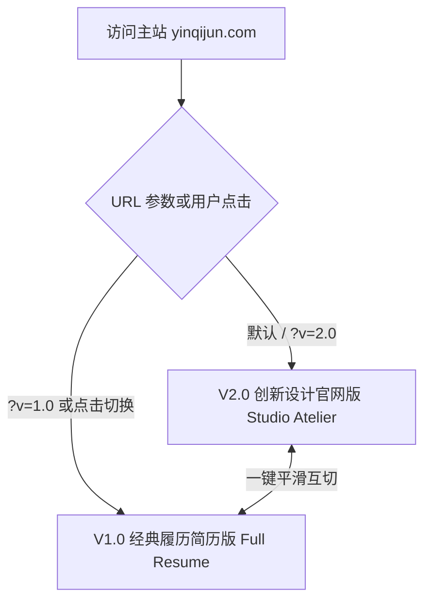

# 尹启钧 · 个人主页与数字化工坊 (Personal Homepage & Atelier)

> 线上访问地址：[https://yinqijun.com](https://yinqijun.com) 或 [http://8.152.214.247](http://8.152.214.247)

本项目为尹启钧（高阶产品架构师 / 全栈开发者）的个人官方网站与产研成果展台。采用 **React 19 + TypeScript + Tailwind CSS v4 + Vite 8** 构建，严格遵循现代前端极简美学与 Anti-Slop 无冗余设计规范。

---

## 🌟 双版本架构体系 (Dual-Version Architecture)

为了同时兼顾**【独立产研工坊官网的商业设计感】**与**【传统招聘场景的高效信息筛选】**，本项目开创性地设计并落地了双版本无缝切换架构：



### 1. V2.0 创新设计官网版 (默认线上版本)
* **核心定位**：独立产品架构师与 AI 原生全栈工坊（Digital Atelier）。
* **语言风格**：彻底剔除 AI 浮夸词汇（无“赋能、闭环、飞轮、十倍跃升”等套话），回归真实严密的业务语感。
* **特色模块**：
  * **左侧 Sticky 个人锚点**：参考顶级设计工作流（`elaya.design`），常驻头像、状态指示灯、实时跳动的 CST 毫秒等宽时钟与网格点阵水印。
  * **系统架构解构沙盘 (Architecture Blueprint)**：可交互的四层控制台（`业务内嵌而非浮窗对话`、`物理质感与人机反馈`、`决策降噪与信息密度`、`全栈动手跑通高保真`）。
  * **WebGL 物理触觉冲击波 (Tactile Shader Wave)**：汲取 `glimm.dev` 与苹果 iOS 交互美学，基于 WebGL Fragment Shader、菲涅尔高光（Fresnel）与 Inigo Quilez 余弦调色板（Cosine Palette）。点击“交流探讨”时全屏触发物理流光，波峰瞬时无缝展开联系弹窗。
  * **物理文件夹索引卡 (Index Cards & Field Notes)**：汲取物理文件标签交互灵感，将 AI 原生思考与 B 端降噪方法论以彩色索引手感呈现。
  * **工坊级交付双卡**：配备交互式“含全代码交付”开关（Toggle），清晰定义 B 端中台与 AI 原生的交付清单。
  * **8 项精选实战作品**：双列大图瀑布流卡片，配备原图灯箱（Lightbox）与深度案例弹窗抽屉（Case Study Modal）。

### 2. V1.0 经典履历简历版 (HR 与深度背调模式)
* **核心定位**：详尽、客观、数据说话的高阶产品经理/技术专家系统化简历。
* **特色模块**：
  * **5 段完整职业历程**：海一云商、汇浪网络、中兴造价、塔姆网络、汪特文化，包含量化关键战绩。
  * **真实背书与同行评价**：来自运营总监、技术负责人与公司 CEO 的真实合作证言。
  * **学历与专业资质**：统招与设计双重背景。
  * **A4 打印优化**：支持点击一键调用原生打印并输出排版规范的 PDF 简历文件。
* **访问入口**：
  * 页面左上角点击 **`1.0 简历`** 按钮即可即时切换。
  * 直接访问链接：`https://yinqijun.com/?v=1.0`

---

## 🛠️ 技术栈与设计标准 (Tech Stack)

* **核心框架**：React 19 (`react` + `react-dom`)
* **开发语言**：TypeScript 6.x（严格类型推导）
* **样式架构**：Tailwind CSS v4 (`@tailwindcss/vite`) + 纯原生 CSS Variables
* **构建工具**：Vite 8（极速秒级 HMR 与高内聚打包）
* **动效交互**：Framer Motion 12
* **矢量图标**：Lucide React
* **字体系统**：Google Fonts `Geist` (Display/Text) + `Geist Mono` (Code/Time)
* **设计原则**：严格执行同心圆角规则（`inner = outer - gap`），封闭间距比例尺，无死角适配 Light（暖灰白）与 Dark（深黑曜石）双模主题。

---

## 📂 核心代码目录结构

```text
personal-homepage/
├── README.md                 # 项目全局说明文档与版本指南
├── web/                      # 前端工程根目录
│   ├── deploy.sh             # 阿里云 ECS 一键打包部署脚本
│   ├── package.json          # 依赖与脚本配置
│   ├── vite.config.ts        # Vite + Tailwind v4 配置文件
│   ├── public/               # 静态资源 (图片、SVG 图标、favicon)
│   │   └── assets/           # 项目截图、高保真大屏与原型素材
│   └── src/
│       ├── App.tsx           # V2.0 创新设计官网版 (主入口 & 路由分发)
│       ├── App.v1.tsx        # V1.0 经典履历简历版 (完整履历与背书)
│       ├── index.css         # Tailwind v4 主题变量、点阵纹理与 A4 打印样式
│       ├── main.tsx          # React 应用挂载入口
│       └── data/
│           └── resume.ts     # 真实案例、场景大图、度量指标与个人数据源
```

---

## 💻 本地开发与构建 (Local Development)

进入前端工程目录：

```bash
cd web
```

### 1. 安装依赖
```bash
npm install
```

### 2. 启动本地开发服务
```bash
npm run dev
```
启动后在浏览器打开：`http://localhost:5173/`。

### 3. 生产环境构建打包
```bash
npm run build
```
编译产物将输出至 `web/dist/` 目录。

### 4. 预览生产构建
```bash
npm run preview
```

---

## 🚀 阿里云 ECS 一键上线部署 (Deployment)

服务器运行在**阿里云 ECS**，采用 Nginx 进行静态托管与反向代理。

### 1. 服务器配置概览
* **公网 IP**：`8.152.214.247`
* **绑定域名**：`yinqijun.com` / `www.yinqijun.com`
* **线上根目录**：`/var/www/personal-homepage/`
* **历史备份目录**：`/var/www/personal-homepage-v1.0/`
* **SSH 认证密钥**：`~/.ssh/ecs_homepage`

### 2. 执行一键部署脚本
在本地 `web/` 目录下直接运行：

```bash
cd web
./deploy.sh
```

该脚本将自动执行以下流程：
1. 压缩优化 `public/assets/projects/` 下的超高清截图（JPG/PNG）。
2. 调用 `npm run build` 进行生产编译和类型校验。
3. 通过 `rsync` 配合专用 SSH 密钥增量同步至阿里云 `/var/www/personal-homepage/`。
4. 远程执行 `nginx -s reload` 平滑生效。

---

## 📋 个人 ICP 备案合规指南 (Personal ICP Compliance)

本项目已严格按照**中华人民共和国工信部**及**河南省通信管理局（豫ICP备）**针对个人性质网站备案的法定要求完成去商业化与敏感项合规改造：

1. **去商业化与身份合规**：
   - 彻底剔除所有“产品经理”、“产品专家”、“产品实践者”、“商业架构”、“交付服务”等商业运营主体词汇。
   - 网站定位与称号规范为：**“Web 技术爱好者 · 前端工程探索与个人学习笔记”**。
2. **剔除敏感与前置审批类项目**：
   - 彻底剔除语音聊天室、社交陪聊、虚拟货币/充值、电商商城等个人备案绝对禁令项目（如原嘀哩语音、浣熊派对、爱玩酱、次元星球等）。
   - 仅保留合规纯技术向的前端工程与可视化案例（数据大屏布局、电商看板前端、在线学习考核组件、流程图拓扑渲染）。
3. **底部法定备案号与工信部跳转链接**：
   - 依据《非经营性互联网信息服务备案管理办法》，页面底部中央规范展示备案号，并点击**必须且只能直链国家工信部政务服务平台**：`https://beian.miit.gov.cn/`。
   - 待管局审核下发正式备案号后，只需在 `web/src/App.tsx` 顶部的 `ICP_NUMBER` 常量中将 `豫ICP备2026000001号-1` 替换为正式备案号即可，重新执行 `./deploy.sh` 即可 1 秒同步上线。

---

## 📄 授权与许可

© 2026 尹启钧 (Qijun Yin). All rights reserved. 个人技术分享与学习博客。
